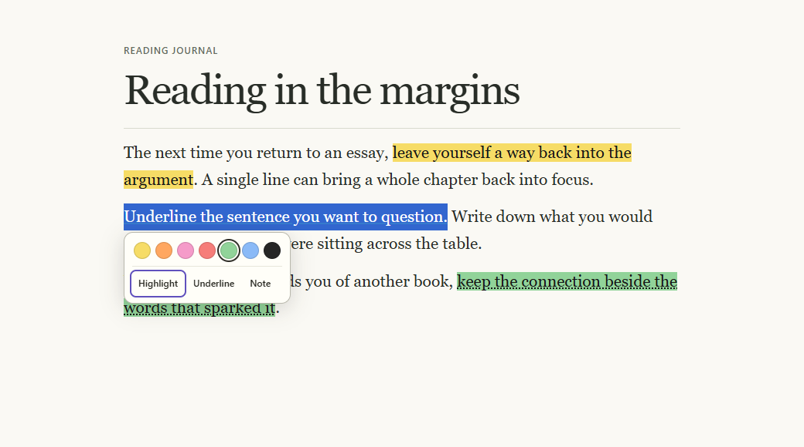
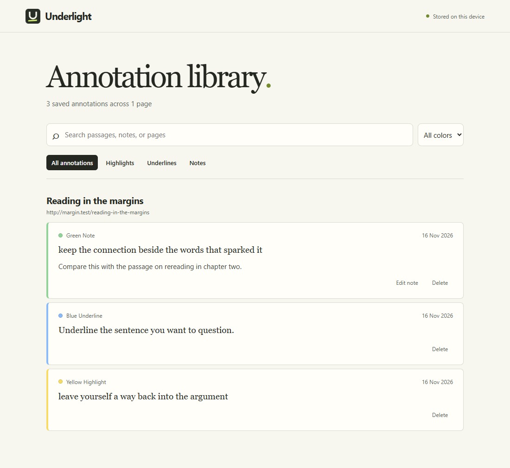

# Underlight

Underlight is a local-first annotation extension for desktop Google Chrome, Microsoft Edge, and Brave. Select a passage to highlight it, underline it, or attach a note. Reopen the page to see your marks, or click the toolbar icon to browse everything you saved.

## Install from source

1. Download and extract the repository ZIP from GitHub, or clone it to a folder you intend to keep.

   ```sh
   git clone https://github.com/vikasvyas11/web-highlight.git
   cd web-highlight
   ```

2. Open your browser's extension manager.

   | Browser | Address to paste in the address bar |
   | --- | --- |
   | Google Chrome | `chrome://extensions` |
   | Microsoft Edge | `edge://extensions` |
   | Brave | `brave://extensions` |

3. Enable **Developer mode**. Choose **Load unpacked** and select the **extension** folder inside the checkout. It contains `manifest.json`. Installation requires only the files in that folder.
4. Refresh any webpages that were already open. Use your browser's extensions menu to pin Underlight if you want its library one click away.

Use a desktop browser based on Chromium 134 or newer. The extension runs directly from its folder. Keep that folder in the same location when updating.

## Mark a passage



1. Select ordinary text on an HTTP or HTTPS webpage. A small toolbar appears next to the selection.
2. Choose **yellow**, **orange**, **pink**, **red**, **green**, **blue**, or **black**. The outlined swatch shows the current choice.
3. Choose **Highlight** for a filled mark or **Underline** for a line under the passage. Choose **Note** to write a comment, then click **Save**.
4. Click a saved passage to change its color, review or edit its note, or delete the annotation. Notes have a dotted underline to distinguish them from plain highlights. Press **Escape** to dismiss the toolbar or editor.

You can also right-click selected text and choose an action in the **Underlight** submenu. These actions use the current page tab's selected color, initially yellow. For keyboard selection, enable your browser's caret browsing and extend a selection with Shift and the arrow keys. On releasing Shift, use Tab or Shift+Tab to move through the toolbar controls and Enter to activate one.

## Use the library



Click Underlight's toolbar icon or open the extension's options. The library groups annotations by page and places the most recently annotated pages first. Search the quoted text, note, title, or URL. Combine the type tabs with the color filter to narrow the list. Click a page title to reopen the source in a new tab. **Edit note** also works here if the source is offline or the passage has been removed.

## What gets saved

Each annotation contains its type, color, selected text, up to 64 nearby characters on either side, original character offset, optional note, page title, URL, creation time, and an ID. Underlight stores each record separately in the browser profile's extension-local storage. Annotations created in different tabs can coexist.

On return, Underlight finds the original wording and uses the surrounding text to resolve repeated passages. It retries when the page updates. Moving a paragraph or changing inline formatting can preserve a match. Edited or ambiguous passages may lose their on-page mark. Their saved text and notes remain in the library.

Underlight stores annotations only. Opening the source still requires access to the webpage. The library itself works offline. Query parameters and hash routes beginning with `#/` or `#!/` identify different pages. Ordinary section links on a page share its marks.

## Privacy, permissions, and limits

- **Page access** lets the content script read selected passages and repaint saved marks on supported sites. The browser may describe this as access to data on websites. You can restrict site access in the browser's extension settings.
- **storage** saves the library locally. **contextMenus** adds the right-click actions. There are no accounts, analytics, remote scripts, or sync services.
- Each browser and profile has its own library. Removing the extension clears that profile's Underlight storage. For unpacked installs, changing the folder path can assign a different extension ID and open an empty library. Keep the same folder when updating.
- Chromium's default local storage quota is 10 MB. A failed save shows an error in the editor. Remove unneeded annotations in the library if you reach the quota. [Chrome storage documentation](https://developer.chrome.com/docs/extensions/reference/api/storage)
- Browser settings, extension stores, native PDF viewers, local files, embedded frames, shadow-root content, and form editors are outside this version's annotation surface. Page annotations cover selectable text in the main HTML document.

## Update an existing installation

Run `git pull --ff-only` in the checkout, or replace its files in place with the contents of a newer download. Use **Reload** on Underlight's card in the extension manager and refresh your open webpages. Keep the extension installed while updating.

## Development and verification

The extension uses Manifest V3, plain JavaScript and CSS. There is no runtime build or package installation. For repository development, install Node.js 22.12+ and Git, then run the following commands from the root.

```sh
npm ci
npx playwright install chromium
npm test
npm run docs:test
```

The browser integration test uses a disposable profile and a locally fulfilled test page. On Windows it uses the standard Chrome installation when present. Otherwise it uses Playwright's Chromium build. It exercises the selection toolbar, every type/color combination, persistence after restarting the browser, changes to page content, in-page navigation, library search, editing and deletion. To select a browser explicitly, pass its executable path as an argument.

```powershell
npm test -- "C:/Program Files/Google/Chrome/Application/chrome.exe"
npm test -- "C:/Program Files (x86)/Microsoft/Edge/Application/msedge.exe"
npm test -- "C:/Program Files/BraveSoftware/Brave-Browser/Application/brave.exe"
```

| Location | Contents |
| --- | --- |
| `extension/manifest.json`, `background.js` | Browser permissions, entry points, toolbar and context menu actions |
| `extension/anchors.js` | Text indexing, capture, context matching and DOM range restoration |
| `extension/content.js`, `marks.css` | Selection tools, note editor and CSS Custom Highlight rendering |
| `extension/shared.js` | Storage keys, page identity and colors |
| `extension/library.*` | Local search, filters and annotation management |
| `tests/extension.mjs` | End-to-end browser checks |
| `docs/`, `scripts/` | HTML guide sources, generated site and documentation tooling |

Open **Documentation.html** from the repository for the offline HTML handbook. Edit the sources under `docs/` or this README, then run `npm run docs:test` and include the rebuilt site in your commit.

## Contribute

Create a branch for the change and open a pull request against `main`. For annotation bugs, include the browser version, whether the page changes after loading, and a short example you can share publicly. Use synthetic text in reports about private pages. Keep issue reports and pull requests free of saved private annotations.

## License

Underlight is distributed under the MIT License. The bundled Manrope documentation font uses the SIL Open Font License. See `LICENSE` and `docs/fonts/Manrope-OFL.txt`.
